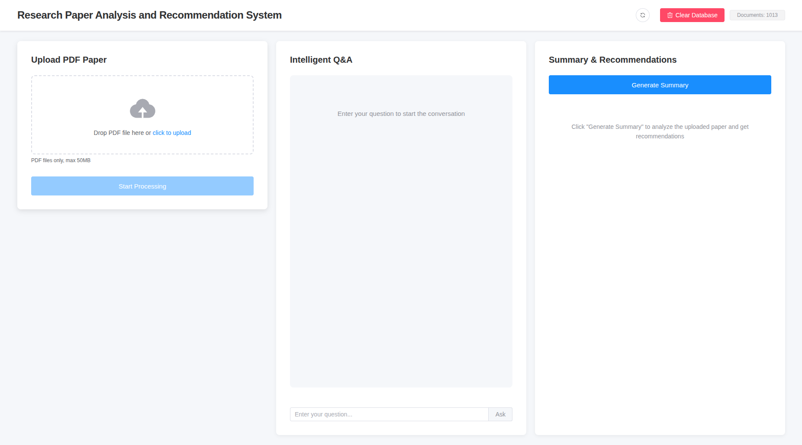
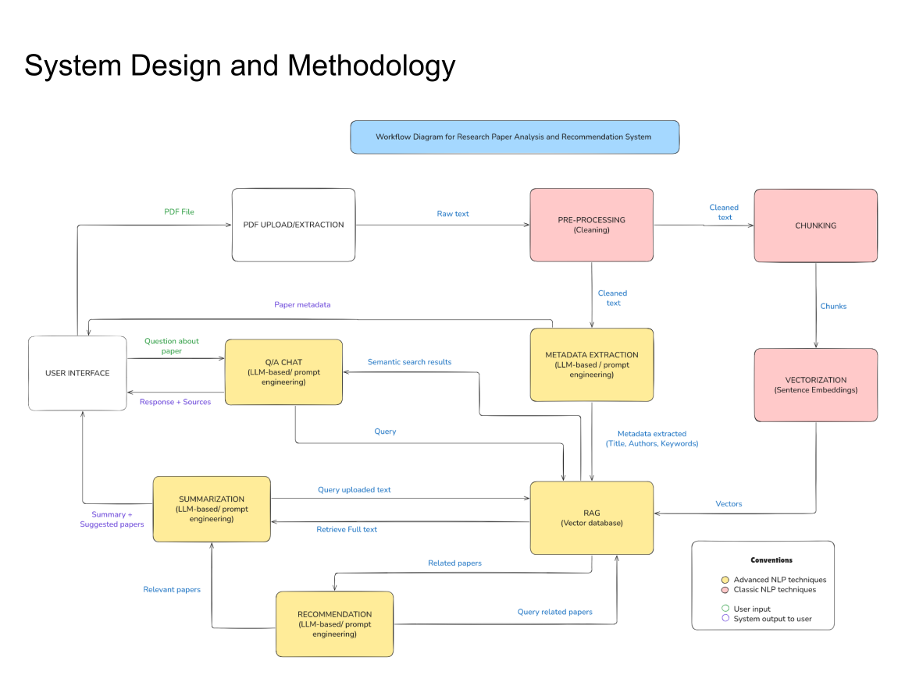

# Research Paper Analysis and Recommendation System

> **Academic group project:** This application was developed as a group project for course COMP8460. It is intended for educational purposes only.

This project is a recommender and analysis system for academic research papers.

The application takes a PDF, processes its content and extracts relevant metadata
(title, authors, keywords, abstract and year). The system can also answer questions
about the uploaded papers (RAG), generate a summary of the latest uploaded paper and
recommend related papers.

Recommendations are based on a preloaded dataset of 997 papers (metadata and abstract
embeddings) taken from the Kaggle Cornell University
[arXiv dataset](https://www.kaggle.com/datasets/Cornell-University/arxiv). The 10 most
similar papers are retrieved from the vector store and passed to the LLM, which returns
5 recommendations in APA 7 format. If fewer than 5 relevant papers are found, the list
is completed with articles from the references of the uploaded document.



## Architecture



1. **PDF upload and extraction:** the user uploads a PDF and its raw text is extracted.
2. **Pre-processing and chunking:** the text is cleaned and split into overlapping chunks.
3. **Vectorization:** each chunk is turned into a sentence embedding and stored in the
   vector database (Chroma).
4. **Metadata extraction:** an LLM extracts the title, authors, keywords, abstract and year.
5. **Q&A:** a question is embedded, the most similar chunks are retrieved (RAG) and the
   LLM answers from them, returning the answer with its sources.
6. **Summarization and recommendation:** the full text of the uploaded paper is retrieved,
   related papers are found by semantic search, and the LLM writes a summary and
   recommends related papers.

Classic NLP techniques (cleaning, chunking, embeddings) prepare the text, and LLM-based
prompt engineering is used for metadata extraction, Q&A, summarization and recommendation.

## Technology Stack

- **Backend**: Flask
- **LLM**: any OpenAI-compatible API (DeepSeek, OpenAI, OpenRouter, Ollama, ...) for
  metadata extraction, Q&A answers and summaries. Default: DeepSeek (`deepseek-chat`)
- **Embeddings**: any OpenAI-compatible embeddings API, or local with sentence-transformers.
  Default: `BAAI/bge-large-en-v1.5` through the SiliconFlow API
- **Frontend**: Vue 3 + Element Plus + Vite
- **PDF Processing**: PyPDF2
- **Knowledge Base**: Chroma

## Quick Start

### Prerequisites

- Python 3.9+
- Node.js 16+
- An API key for an OpenAI-compatible LLM provider, e.g. [DeepSeek](https://platform.deepseek.com/)
  (or a local [Ollama](https://ollama.com/) server, no key needed)
- An API key for an embeddings provider, e.g. [SiliconFlow](https://siliconflow.cn/)
  (or local embeddings, no key needed)
- Conda or another virtual environment (recommended)

### 1. Configure the LLM and Embeddings

In the root folder, copy the example environment file and fill in your keys:

```bash
cp .env.example .env
```

```
LLM_BASE_URL=https://api.deepseek.com/v1
LLM_API_KEY=your-api-key
LLM_MODEL=deepseek-chat

EMBEDDING_PROVIDER=api
EMBEDDING_BASE_URL=https://api.siliconflow.cn/v1
EMBEDDING_API_KEY=your-siliconflow-api-key
EMBEDDING_MODEL=BAAI/bge-large-en-v1.5

SECRET_KEY=change-me
```

The `.env` file is ignored by git. Never commit your real keys.

#### Choosing an LLM provider

The app works with any provider that offers an OpenAI-compatible API. Set `LLM_BASE_URL`,
`LLM_API_KEY` and `LLM_MODEL`; `.env.example` has ready-to-use examples for DeepSeek,
OpenAI, OpenRouter and Ollama. Each task can use a different model by setting
`SUMMARY_LLM_*`, `QA_LLM_*` or `METADATA_LLM_*` (`BASE_URL`, `API_KEY`, `MODEL`, `TIMEOUT`).
Unset values fall back to `LLM_*`.

To run without any API key, use Ollama for the LLM and local embeddings:

```
LLM_BASE_URL=http://localhost:11434/v1
LLM_API_KEY=
LLM_MODEL=llama3.1
EMBEDDING_PROVIDER=local
EMBEDDING_MODEL=BAAI/bge-large-en-v1.5
```

Local embeddings need `pip install -r backend/requirements-local.txt`. The model is
downloaded on first use to the `cache/` folder at the project root.

**Changing the embedding model:** vectors from different models cannot be compared, so
each embedding model has its own knowledge base. After changing `EMBEDDING_MODEL`, re-upload
your papers and rebuild the preloaded papers (step 2). Switching only between `api` and
`local` for the same model keeps the existing knowledge base.

Older `.env` files with only `DEEPSEEK_API_KEY` and `SILICONFLOW_API_KEY` still work:
DeepSeek is used for summaries and Q&A, SiliconFlow for metadata extraction and embeddings.

### 2. Generate the Preloaded Papers

The recommendation dataset (`backend/papers_emb.json`) is not stored in the repository
because of its size. Generate it once before starting the backend:

```bash
cd backend/

# Install the dataset dependencies (includes the backend dependencies)
pip install -r requirements-dataset.txt

# Download the arXiv dataset with kagglehub and build papers_emb.json
python build_dataset.py
```

The script reads the first 1000 records of the arXiv dataset, keeps the papers with a
meaningful title and abstract (997 papers) and embeds each abstract with the embedding
provider and model set in `.env`, the same ones the app uses. It also writes
`papers_emb.meta.json`, which records the embedding model. The first run downloads the arXiv
dataset (several GB), so it can take a while. kagglehub may ask for
[Kaggle API credentials](https://github.com/Kaggle/kagglehub#authenticate). With
`EMBEDDING_PROVIDER=local`, also install `requirements-local.txt`; the embedding model is
downloaded on first use (about 1.3 GB for `BAAI/bge-large-en-v1.5`).

Downloads are stored in the `cache/` folder at the project root (ignored by git). Once `papers_emb.json` is generated you can delete `cache/`
to free the space; it is only needed to rebuild the dataset.

If you already have the dataset, pass the file directly:

```bash
python build_dataset.py --arxiv-path /path/to/arxiv-metadata-oai-snapshot.json
```

Without this file the backend still starts, but no preloaded papers are available for
recommendations.

### 3. Start Backend

Open a terminal in the root folder. It is recommended to run the application
in a virtual environment.

```bash
# Move inside the backend folder
cd backend/

# Install dependencies (if needed)
pip install -r requirements.txt

# Start the server
python app.py
```

Backend will run at `http://localhost:5000`

On the first start, the preloaded papers in `backend/papers_emb.json` are loaded into
the Chroma knowledge base.

### 4. Start Frontend

Open a second terminal in the root folder to start the frontend application.

```bash
# Navigate to frontend directory
cd frontend

# Install dependencies (first time)
npm ci

# Start development server
npm run dev
```

Frontend will run at `http://localhost:3000`. Requests to `/api` are proxied to the backend.

### 5. Access System

Open `http://localhost:3000` in your browser.

## API Endpoints

| Endpoint | Method | Description |
|----------|--------|-------------|
| `/api/upload` | POST | Upload a PDF file, extract its metadata and add it to the knowledge base |
| `/api/ask` | POST | Ask a question, answered from the most relevant chunks in the knowledge base |
| `/api/summarize` | POST | Summarize the latest uploaded paper and recommend related papers |
| `/api/stats` | GET | Get knowledge base statistics |
| `/api/clear` | POST | Clear the knowledge base |

## Configuration Parameters

Adjustable in `backend/config/settings.py`:

- `CHUNK_SIZE`: Text chunk size in words (default: 500)
- `CHUNK_OVERLAP`: Chunk overlap in words (default: 50)
- `TOP_K`: Number of chunks retrieved to answer a question (default: 3)
- `MAX_CONTENT_LENGTH`: Maximum upload size (default: 50 MB)

## Limitations

- `/api/summarize` only works on the most recently uploaded paper.
- Recommendations completed from the paper's references are generated by the LLM
  and should be verified, as they may be inaccurate.

## Acknowledgements

This application was built as a group project for COMP8460.
It is the result of the shared work of all group members, who contributed to the
research, design, implementation, testing, report and presentation of the project.
Thanks to every member of the team for their contributions.
